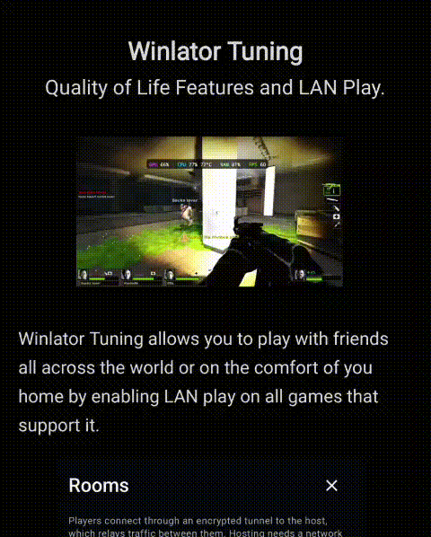

# Winlator Tuning Releases

 

Improvements and features for Winlator Ludashi

# About Winlator 

Winlator is an Android application that lets you run Windows (x86\_64) applications with Wine. It supports standard `x86_64` containers using Box86/Box64, as well as `Arm64EC` containers which utilize FEXCore (for 64/32-bit) or an optional WowBox64 (for 32-bit).

# What is Winlator Tuning?

Winlator Tuning is a fork of **Winlator Ludashi** project by [StevenMX](https://github.com/StevenMXZ/Winlator-Ludashi) and includes all recent commits and QOL improvements and functionalities made by [palazos](https://github.com/palazos/Winlator-Tuning-Releases).

Some of the Functionalities and Improves are:

👥 Multiplayer VPN Engine Feature (NEW)
- Players can make private or public rooms to connect with each other starting a host in his own devices.
- That allows to play Lan games between devices with an enrypted connection with friends.
- When hosting rooms, it's preferable to use Wi-Fi because mobile networks use symmetric NAT. Current Version of Palazos VPN Engine doesnt allow that.
- Mobile networks are allowed to join or host rooms only on IPv6 Cases.
- Winlator Tuning must be updated to use this feature, if not directory connection can fail for certification to the broker.

🕹️ Game Controllers "Dildo Feature"
- Multiple controllers with hot-swap on disconnect while playing, similar to Dildo — pads can be unplugged mid-game without breaking input and 
- Controllers are detected on the fly
- Vibration works as it should.

🎮 Scan Games

- New Scan Games flow: pick a games folder and select your games and exes.

 🗑️ Remove All Shortcuts

- Delete every shortcut across all containers in one step (with confirmation).

# Installation

1.  Download and install the latest APK from this repository's [Releases section](https://github.com/palazos/Winlator-Tuning-Releases)
2.  Allow VPN to play with friends and make rooms.
   
# Credits and Third-party apps

- **Original Winlator** by [brunodev85](https://github.com)
- **Original Winlator Bionic** by [Pipetto-crypto](https://github.com)
- **Winlator Ludashi** project by [StevenMX](https://github.com/StevenMXZ/Winlator-Ludashi)
- **Winlator (coffincolors fork)** by [coffincolors](https://github.com)
- **Ubuntu RootFs (Bionic Beaver)**: [://ubuntu.com](https://ubuntu.com)
- **Wine**: [winehq.org](https://winehq.org)
- **Box86/Box64** by [ptitseb](https://github.com)
- **FEX-Emu** by [FEX-Emu](https://github.com)
- **PRoot**: [proot-me.github.io](https://github.io)
- **Mesa (Turnip/Zink/VirGL)**: [mesa3d.org](https://mesa3d.org)
- **DXVK**: [://github.com](https://://github.com)
- **VKD3D**: [gitlab.winehq.org/wine/vkd3d](https://winehq.org)
- **D8VK**: [://github.com](https://://github.com)
- **CNC DDraw**: [://github.com](https://://github.com)
- **Rust Engine & Tooling**: [rust-lang.org](https://rust-lang.org)
- **WireGuard**: [wireguard.com](https://wireguard.com)
- **MQTT**: [mqtt.org](https://mqtt.org)

