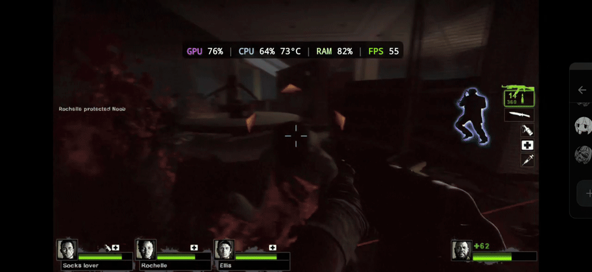
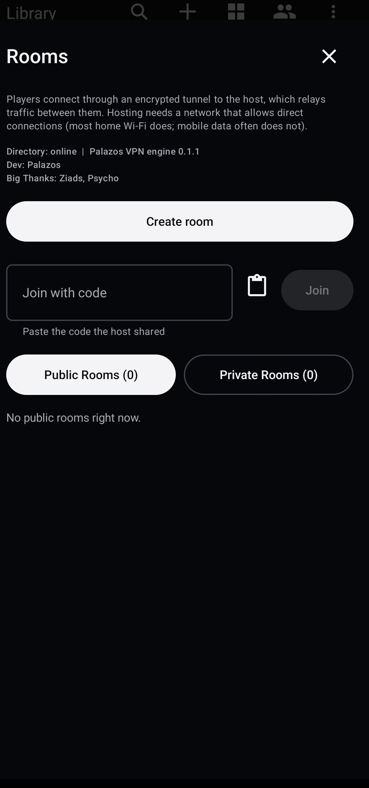
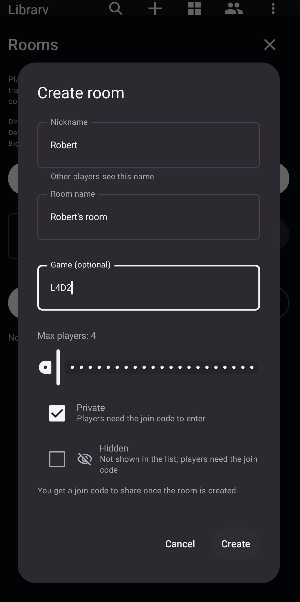
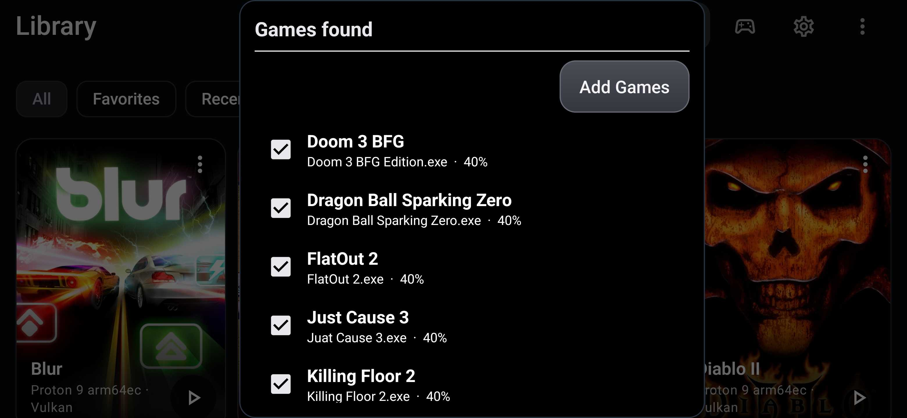
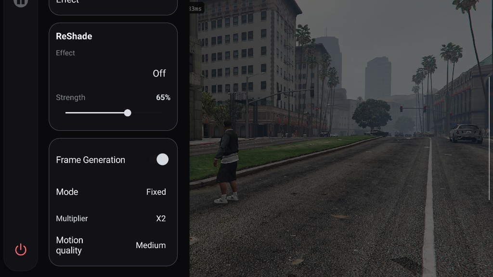
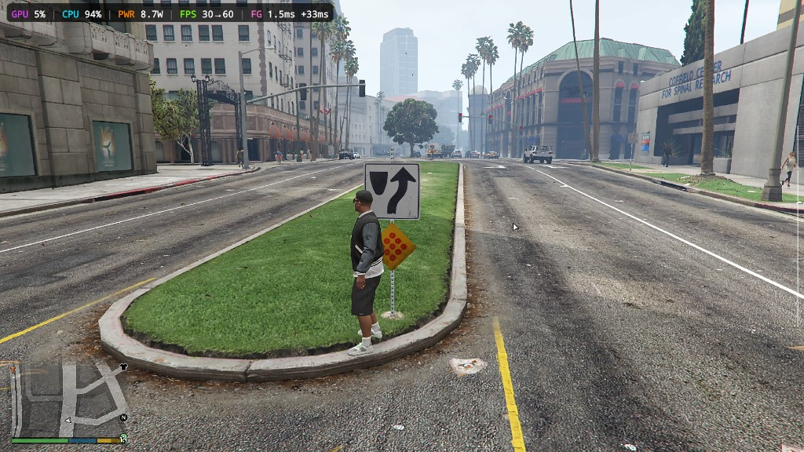
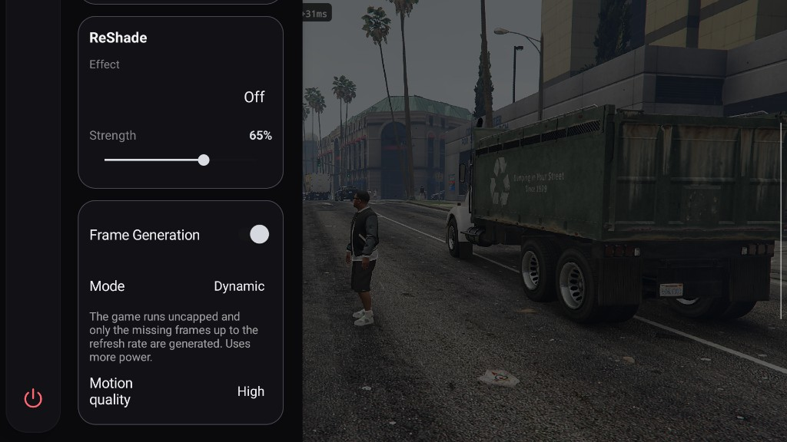
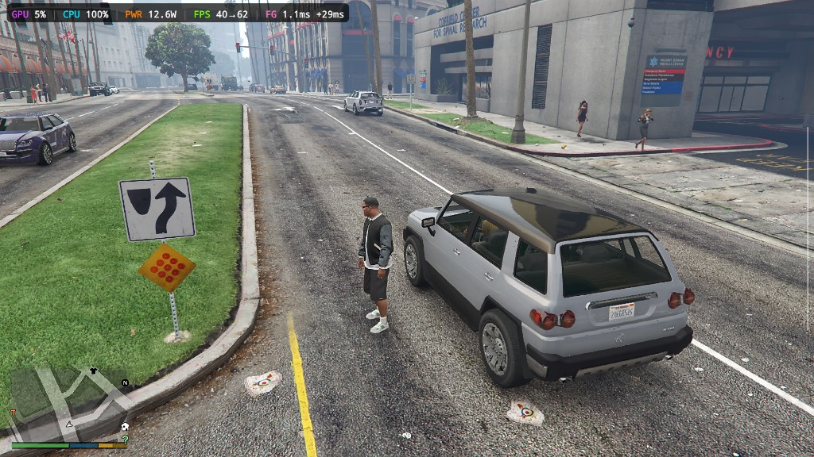

# Winlator Tuning

# Quality of Life Features and LAN Play.

Winlator Tuning allows you to play with friends all across the world or on the comfort of you home by enabling LAN play on all games that support it.

 

Just create a room and invite friends over. You can open private rooms to invite your friends or even open public rooms so any stranger can hop and play any game you playing and imitate an online server. Or just join any public server of anyone that is playing the same game as you.

# Over 2,000 games with Native LAN support and many more with mods to add support to them.

Join us to test them...

You can check which games support LAN here
[List of games with LAN multiplayer](https://www.pcgamingwiki.com/wiki/List_of_games_with_LAN_multiplayer)

# Automatically import all your games with a single tap.

# Smoother gameplay with custom Tuning Vulkan Frame Generation. (NEW)

Turn Frame Generation on from the in-game overlay (Vulkan). The game keeps drawing real frames, and extra ones are interpolated in between so motion looks smoother.

This Frame Generations is oriented to VSYNC. Generated frames land on the display refreshes the game would miss, so you can leave VSYNC on and still fill the screen.
 

**Fixed** caps the game at a fraction of the refresh rate (X2 or X3) and generates the missing frames. Uses less power and keeps a steady pace.

 

**Dynamic** lets the game run uncapped and only generates the frames the display would otherwise repeat, up to the refresh rate. Uses more power, but you keep every extra real frame the game can produce.

It allows you to play games on max graphics without losing the VSYNC, smoother and less latency if you have active cooling.

 

Watch an uncompressed showcase [here](https://palazo.uncompressed.io/screen-20261021-143612).

# Installation

1.  Download and install the latest APK from this repository's [Releases section](https://github.com/palazos/Winlator-Tuning-Releases)
2.  Allow VPN to play with friends and make rooms.

# Special Thanks too:
Ziad and Psycho for their trust, patience, and time.
   
# Credits and Third-party apps

- **Original Winlator** by [brunodev85](https://github.com)
- **Original Winlator Bionic** by [Pipetto-crypto](https://github.com)
- **Winlator Ludashi** project by [StevenMX](https://github.com/StevenMXZ/Winlator-Ludashi)
- **Winlator (coffincolors fork)** by [coffincolors](https://github.com)
- **Ubuntu RootFs (Bionic Beaver)**: [://ubuntu.com](https://ubuntu.com)
- **Wine**: [winehq.org](https://winehq.org)
- **Box86/Box64** by [ptitseb](https://github.com)
- **FEX-Emu** by [FEX-Emu](https://github.com)
- **PRoot**: [proot-me.github.io](https://github.io)
- **Mesa (Turnip/Zink/VirGL)**: [mesa3d.org](https://mesa3d.org)
- **DXVK**: [://github.com](https://://github.com)
- **VKD3D**: [gitlab.winehq.org/wine/vkd3d](https://winehq.org)
- **D8VK**: [://github.com](https://://github.com)
- **CNC DDraw**: [://github.com](https://://github.com)
- **Rust Engine & Tooling**: [rust-lang.org](https://rust-lang.org)
- **WireGuard**: [wireguard.com](https://wireguard.com)
- **MQTT**: [mqtt.org](https://mqtt.org)

